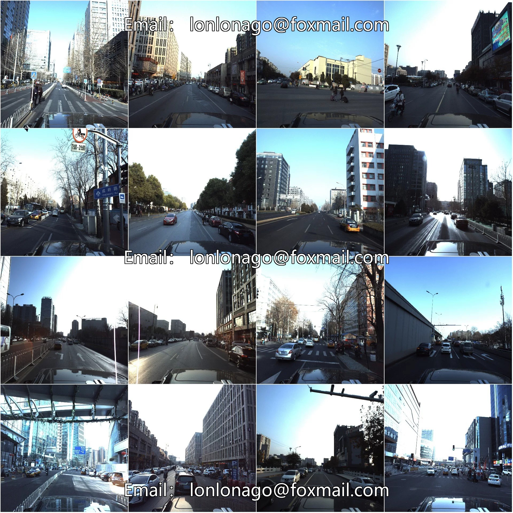
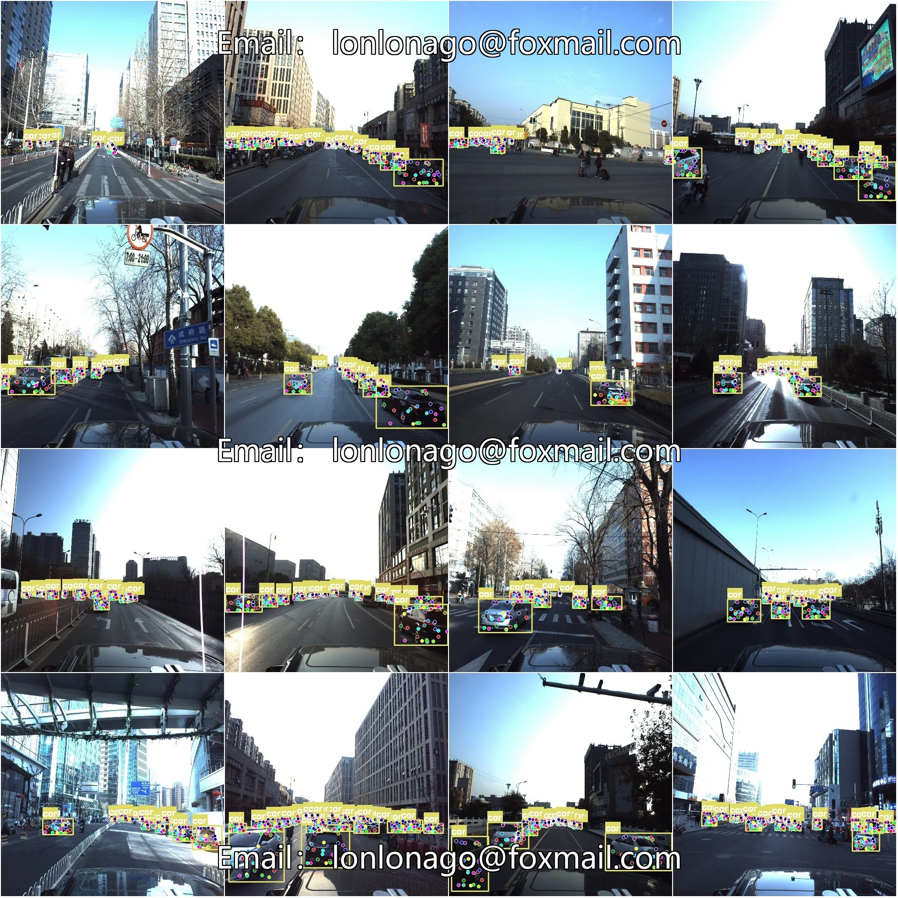

# Vehicle keypoint detection dataset COCO+YOLO format 4283 images 1 category 2

## Body

Vehicle Key Point Detection Dataset COCO+YOLO Format: 4283 Images, 1 Category, 24 Key Points

Tips: Due to the dataset's replicability, please confirm compliance with requirements before purchasing.

Dataset Format: YOLO Key Point Format (Note: This is not the YOLO format for object detection or segmentation, but merely includes JPG images and corresponding YOLO format TXT files.)
Number of Images (JPG File Count): 4283
Number of Annotations (TXT File Count): 4283
Training Set Count: 3426
Validation Set Count: 429
Test Set Count: 428
Number of Annotation Categories: 1
Annotation Category Name: ['car']
Number of Key Points Annotationd: 24
Key Point Names

front_up_right","front_up_left","front_light_right","front_light_left","front_low_right","front_low_left","central_up_left","front_wheel_left","rear_wheel_left","rear_corner_left","rear_up_left","rear_up_right","rear_light_left","rear_light_right","r

ear_low_left","rear_low_right","central_up_right","rear_corner_right","rear_wheel_right","front_wheel_right","rear_plate_left","rear_plate_right","mirror_edge_left","mirror_edge_right

Number of boxes per category
car boxes = 70383
Total number of boxes = 70383
Image resolution: 3384x2710
Important Note: The dataset has been split into training, validation, and test sets, which can be directly used for training Yolov5-pose, Yolov8-pose, Yolov11-pose, or Yolov26-pose.
Special Remark: This dataset does not guarantee the accuracy of the trained models or weight files.

## Images

## Payment

Here is a pay link on Stripe ( https://buy.stripe.com/3cs8yP7sY87d0vu9AB ). Please contact me lonlonago@foxmail.com after funding $89, and I will send you a complete data files , thank you!

